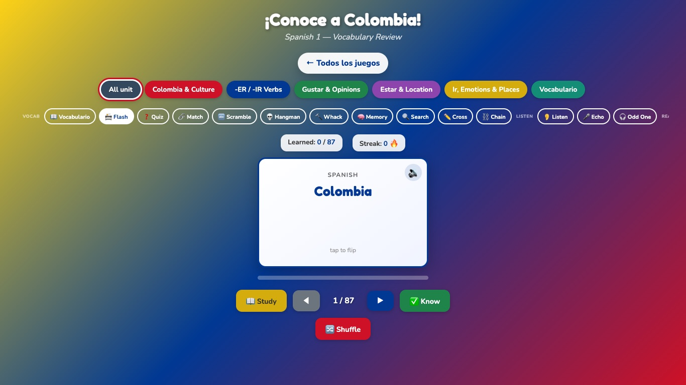
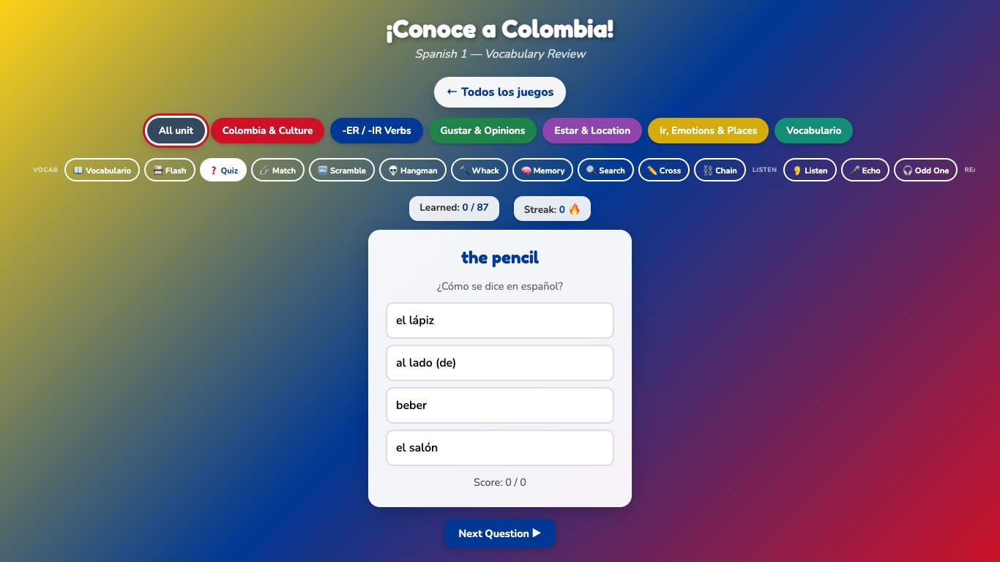
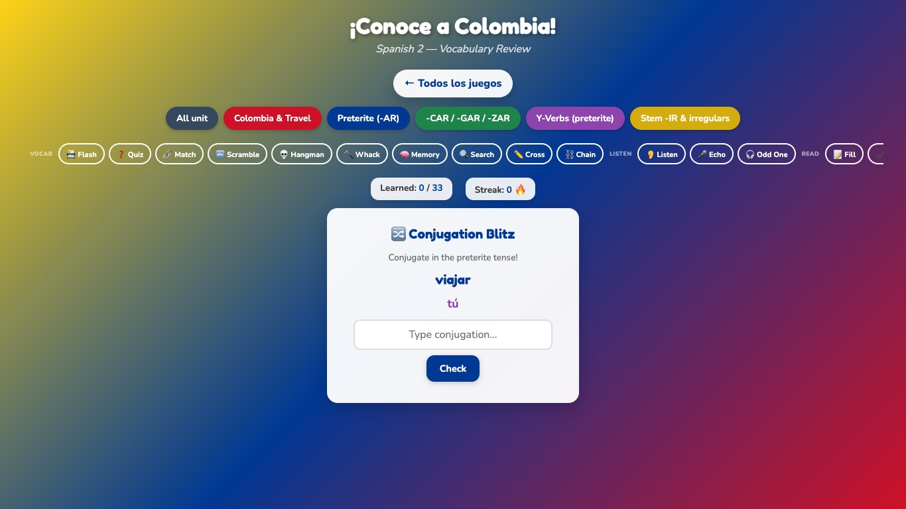
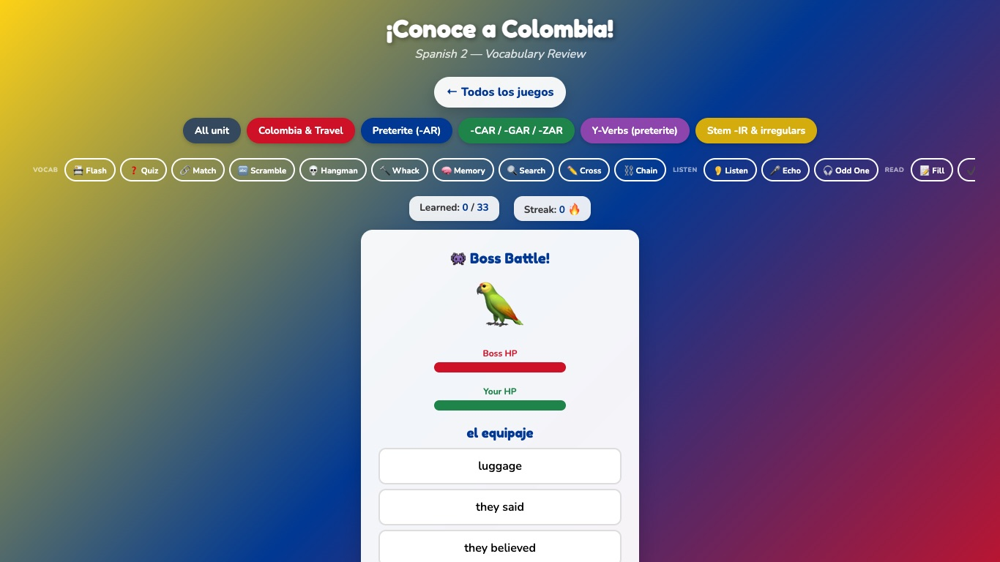
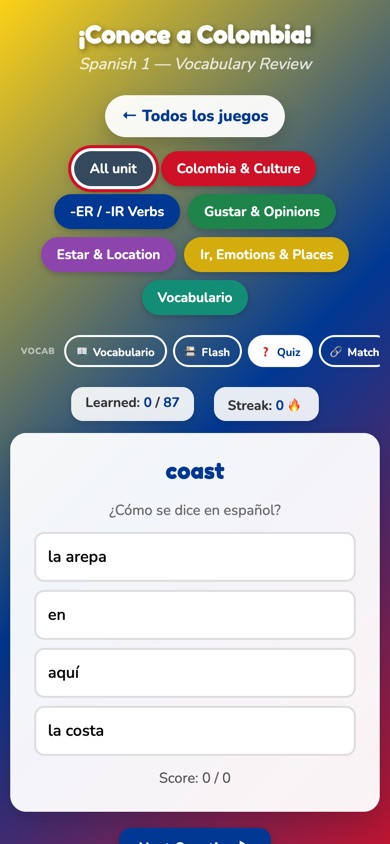

## Overview

*¡Conoce a Colombia!* is a set of vocabulary games I built for my own high-school Spanish 1 and Spanish 2 classes during our unit on Colombia. Each level has **26 game modes**: flashcards, quizzes, listening and speaking practice, conjugation drills, word puzzles, and arcade games. Every mode reads from **one vocabulary file per level**, so when I add a word, it shows up in all 26 games at once.

The games are public at **[wswede1.github.io/spanish-vocab-games](https://wswede1.github.io/spanish-vocab-games/)**. Anyone can play them with no account. The full classroom site they came from (lessons, teacher pages, and student hubs) stays in a private repository. A small build script copies only the games to the public site, using an allowlist.

{% include figure popup=true image_path="/assets/images/projects/classroom-game-suite/landing.jpg" alt="Landing page of the games site titled ¡Conoce a Colombia!, with a card for Español 1 (87 words, 6 themes) and Español 2 (33 words, 5 themes), each with a Jugar button, and a panel listing the 26 games in each level grouped as Vocab, Listen, Read, Grammar, Write, Arcade, and Culture." caption="The public landing page. Students pick a level; the 26 games are the same in both levels, but the vocabulary is different." %}

## What's in the suite

### Two levels, one unit

| Level | Vocabulary (All unit deck) | Themes |
|---|---|---|
| Spanish 1 | 87 words | Colombia & Culture, -ER / -IR Verbs, Gustar & Opinions, Estar & Location, Ir, Emotions & Places, Vocabulario (school and classroom words) |
| Spanish 2 | 33 words | Colombia & Travel, Preterite (-AR), -CAR / -GAR / -ZAR, Y-Verbs (preterite), Stem -IR & irregulars |

Students open a level, pick the **All unit** deck or one or more themes, and then pick a game. Their score and streak show above every game.

### 26 game modes per level

The modes are grouped by skill, so students meet the same words through recognition, recall, listening, speaking, grammar, and writing:

| Group | Modes |
|---|---|
| Vocab | Flashcards, Quiz, Match, Scramble, Hangman, Whack-a-Word, Memory, Word Search, Crossword, Chain |
| Listen | Listen, Echo (record yourself and compare), Odd One Out |
| Read | Fill in the Blank, True/False |
| Grammar | Conjugation Blitz, Sort It, Build a Sentence, Gender |
| Write | Translation, Prompt Response, Mad Libs |
| Arcade | Falling Words, Quiz Race, Boss Battle |
| Culture | Dialogue |

<figure class="half">
  <a href="/assets/images/projects/classroom-game-suite/sp1-flashcards.jpg"></a>
  <a href="/assets/images/projects/classroom-game-suite/sp1-quiz.jpg"></a>
  <figcaption>Flashcards with recorded audio, and a multiple-choice quiz. The theme chips at the top choose the deck; the bar below them chooses the game.</figcaption>
</figure>

<figure class="half">
  <a href="/assets/images/projects/classroom-game-suite/sp2-conjugation.jpg"></a>
  <a href="/assets/images/projects/classroom-game-suite/sp2-boss.jpg"></a>
  <figcaption>Spanish 2: Conjugation Blitz in the preterite (here with <em>viajar</em>, one of the words added in November 2026), and Boss Battle.</figcaption>
</figure>

### One word list behind every game

Each level's vocabulary is a single file of Spanish–English pairs grouped into themes. Every game reads from that list, so a word added to the file shows up in all 26 games at once. Games that need more than a pair get it from the same data: *Gender* uses the *el/la* nouns, *Conjugation Blitz* uses the infinitives (present tense in Spanish 1, preterite in Spanish 2), and *Sort It* uses the theme names. Typed answers are checked without regard to accents or capitals, so `montana` counts for *montaña*, and the feedback always shows the correct spelling.

### Audio

Every word has a pre-recorded neural text-to-speech pronunciation in Spanish. If a recording is missing or won't play, the game uses the browser's own Spanish voice instead. *Listen*, *Echo*, and *Odd One Out* build whole games around hearing and saying the words.

### Privacy and devices

- **No account, no sign-in, no analytics.** Students just open the page.
- **Progress stays on the device,** in the browser's own storage. The games don't send student data to any server I run.
- **Built for school Chromebooks,** and responsive for phones and tablets.

<figure style="max-width: 320px;">
  <a href="/assets/images/projects/classroom-game-suite/sp1-quiz-mobile.jpg"></a>
  <figcaption>The Spanish 1 quiz on a phone-sized screen.</figcaption>
</figure>

### Try it

- **Play:** [wswede1.github.io/spanish-vocab-games](https://wswede1.github.io/spanish-vocab-games/)
- **Public code:** [github.com/wswede1/spanish-vocab-games](https://github.com/wswede1/spanish-vocab-games)

The rest of this page covers why I built it and how it works under the hood.

## Why I built it

The vocabulary for a unit lives in many places: the textbook list, the slides, the worksheets, and any online practice tools. Each tool needs its own copy of the list. That leads to a few problems I wanted to solve:

- **Practice drifts from instruction.** When a word is added or changed for a class, a separate game tool doesn't know about it unless someone re-enters it by hand.
- **Students need variety.** Learners need to meet each word many times, and in different ways: reading, listening, typing, conjugating, and using it in a sentence. One flashcard deck doesn't do that.
- **The devices and the setting are fixed.** My students use school-managed Chromebooks. I wanted something that needs no account and sends no student data anywhere.
- **Typing Spanish on a Chromebook is awkward.** If answer checking is strict about *ñ* and *á*, it partly tests the keyboard instead of the vocabulary.

My goal was one place where students could practice exactly the words we were studying, in many different ways, with nothing to sign up for.

## Users and classroom context

- **Students:** high-school Spanish 1 and Spanish 2 learners on school Chromebooks. The pages are also responsive, so they work on phones and tablets.
- **Teacher:** me. I needed to update the vocabulary quickly during a unit, without editing any game code.
- **How it's used:** independent practice and review during the Colombia unit. Students choose a level, one or more themes (for example *Colombia & Culture* or *-ER / -IR Verbs*), and a game.

## My role

I designed and built the whole project: the instructional design, the vocabulary lists, the game modes, the audio pipeline, the optional adaptive layer, and the deployment and test scripts. I used AI coding assistants (including Claude Code) to help write and review code. I set the requirements, made the design decisions, and checked the results in the browser and with automated tests.

## Design decisions

### One vocabulary list drives every game

Each level has a single data file (`colombia-vocab-sp1.js` or `colombia-vocab-sp2.js`). It holds plain `{ es, en }` pairs, grouped into themes:

```js
{
  name: 'Colombia & Culture',
  words: [
    { es: 'la selva',     en: 'jungle / rainforest' },
    { es: 'la montaña',   en: 'mountain' },
    { es: 'el vallenato', en: 'vallenato (Colombian folk music)' },
    // ...
  ]
}
```

The page builds an **All unit** deck by merging the themes and removing duplicates (ignoring accents). Students can choose one theme or several. All 26 games read from whatever deck is active.

Some games get extra information from the same simple data, so I never have to tag words by hand:

- **Gender** uses nouns that start with *el* or *la*.
- **Conjugation Blitz** uses infinitives. Spanish 1 drills the present tense; Spanish 2 drills the preterite.
- **Sort It** uses the theme names as its categories.
- **Word Search, Crossword, and Hangman** strip the article and use only the letters.

This means a teacher only needs to edit a word list, not game code. In November 2026 I added 11 Spanish 1 words and 8 Spanish 2 words by editing the two data files. No game code changed for the new words to appear in all modes.

### Accent-insensitive answer checking

When students type an answer, the game compares it after lowercasing and removing accents (Unicode NFD normalization, then stripping the combining marks). So `montana` is accepted for *montaña*. The feedback always shows the correct spelling with accents, so students still see the right form. This is a deliberate trade-off: on these devices, I would rather test whether students know the word than whether they can type an accent.

### Audio for every word, with a fallback

Pronunciation matters for novice learners, and browser speech synthesis is inconsistent across devices. I generated an MP3 for each vocabulary word ahead of time with a neural text-to-speech voice (Microsoft's `es-MX` neural voices via the open-source `edge-tts` tool). The files are named from a "slug" of the Spanish word (for example `vocab-sp1-la-montana.mp3`), so the game can find the right file without a lookup table. If a file is missing or can't play, the game falls back to the browser's built-in Spanish speech synthesis.

### Optional adaptive layer

The source also includes an **optional adaptive layer**. It combines an FSRS-4.5 spaced-repetition scheduler with Bayesian Knowledge Tracing (BKT) for groups of related skills, and stores everything in the browser's IndexedDB (through the Dexie library). When it's turned on (`?adaptive=1`) and a local student profile exists, the flashcard deck is reordered so words that are due for review come first.

In the public build, this code is included but **stays off**. The student-profile setup page is part of the private classroom site and isn't published, so the games always use the full deck. I include it here because it shows where the design is going, not as a feature of the public demo.

## Architecture

There's no framework and no build step for the games themselves. Each level is one self-contained HTML page (about 2,400 lines each) with its own CSS and JavaScript. The page loads its vocabulary file over HTTP.

```text
colombia-vocab-sp1.js / -sp2.js
  { es, en } pairs, grouped by theme
            │
            ▼
All unit deck + theme decks
  (merged, duplicates removed, accents ignored)
            │
            ▼
26 game modes per level
  ├─ audio: vocab-sp1-<slug>.mp3
  │         └─ if missing → browser speechSynthesis (es)
  └─ optional: FSRS + BKT in IndexedDB
            (off unless ?adaptive=1 and a local profile)
```

The only third-party files are Google Fonts and Dexie, both loaded from a CDN.

## Deployment: a public games site from a private classroom repo

The games originally lived inside a larger classroom site, together with lesson pages, student hubs, teacher pages, and an optional cloud-sync setup. I wanted to share the games publicly, both for other teachers and for this portfolio, without publishing anything else.

Hiding links wasn't enough, because every file in a public GitHub Pages repository can be reached by URL. So I split it into two repositories:

1. **Private source repo** (`metz-spanish`): the source of truth for the whole classroom site, including the games.
2. **Public games repo** ([`spanish-vocab-games`](https://github.com/wswede1/spanish-vocab-games)): contains only what `scripts/build-games-site.mjs` produces.

The build script works on an **allowlist**. It copies only the two game pages, the two vocabulary files, the adaptive-layer scripts, the vocabulary audio files (names must match `vocab-sp1-*.mp3` or `vocab-sp2-*.mp3`), and a small landing page, README, and 404 page. It also:

- **Fails the build** if an allowlisted file is missing, if any local link or `import` in the output points to a file that isn't in the output, or if any output path matches a **deny list** (teacher pages, lessons, SQL, docs, profile setup, and similar).
- **Rewrites** the "Back to Student Hub" link on each game page to point to the games landing page instead, and fails if that link isn't found exactly once.

A second script, `scripts/verify-games.mjs`, checks the built site before release. It has **112 checks** in three groups:

- **Vocabulary:** each approved word appears exactly once, in the right theme, with the right English gloss; the All unit decks have the expected sizes (87 words in Spanish 1, 33 in Spanish 2); and no theme has duplicates when accents are ignored.
- **Game logic:** it extracts the real functions from the built game pages and runs them. For example, every verb in every deck must conjugate for every pronoun in Conjugation Blitz; *estar* must conjugate irregularly; new nouns must be picked up by Gender mode; new words must be playable in Hangman and Word Search; and typed answers without accents must be accepted.
- **Published scope:** a list of known private files must **not** be in the output; game pages must link to the games home, not the student hub; and no API keys or database credentials may appear in any published HTML, JavaScript, or Markdown file.

## Privacy and security

- **No sign-in and no analytics.** Students just open the page.
- **Progress stays on the device.** Scores, streaks, and (if used) adaptive data are stored only in the student's own browser (localStorage and IndexedDB). The games don't send data to any server I run.
- **No API keys in public pages.** *Build a Sentence* and *Prompt Response* were designed to optionally ask an AI model for feedback. A key in a public web page can be copied by anyone, so the public build ships with the key empty, and the verify script checks that it stays empty.
- **Smaller public surface.** Only allowlisted files are published, and the original classroom repository was made private.

## Evidence and testing

What I can show, as of the November 2026 release:

- **Automated checks:** `verify-games.mjs` passed all **112 checks** on the release build.
- **Rendering checks:** every game mode was rendered in a browser with every deck selected (All unit and each theme, in both levels). That's **338 renders**, with no JavaScript errors, both locally and on the live site.
- **Bugs found and fixed during the update:** Conjugation Blitz could freeze, because it called itself again whenever it picked something it couldn't conjugate. The Spanish 2 *Colombia & Travel* deck had no verbs for the mode to drill (adding *viajar* fixed that). And in Spanish 1, *estar* didn't produce its irregular forms (*estoy*, *estás*). The verify script now checks for all three.
- **Screenshots** on this page are from the live public site, not mockups.

I have **not** measured learning gains, and I don't make claims about them here. The tool was built for and used with my own classes. A proper evaluation would need a planned comparison, which I haven't done.

## Limitations



- **Two modes don't grade in the public build.** *Build a Sentence* and *Prompt Response* show an "Add API key" note and only show students their own answer. Real feedback would need a small server-side proxy so that no key is exposed in the page.
- **One word has no matching recording.** *el boleto* (Spanish 2) doesn't have its own MP3 yet, so it uses the browser's speech synthesis, which can sound different on different devices.
- **The adaptive layer is off in public.** See [Optional adaptive layer](#optional-adaptive-layer).
- **Large single-file pages.** About 2,400 lines per level is easy to deploy but harder to maintain. The two level pages also share a lot of code that is copied, not shared.
- **CDN dependencies.** Dexie is loaded from a public CDN by major version (`dexie@3`), not a pinned exact version.
- **No learning-outcome data.** See [Evidence and testing](#evidence-and-testing).

## What I learned

- **Put the content in data, not code.** Keeping vocabulary as plain `{ es, en }` pairs, and deriving everything else (gender, verbs, sort categories, puzzle letters) from it, is what made 26 modes manageable. Adding 19 words meant editing two data files and generating their audio.
- **Hiding a link isn't access control.** The first instinct was to remove links from the navigation. But on a static host, every published file is reachable. Building the public site from an allowlist, and making the build fail on anything unexpected, was the real fix.
- **Test the real code.** The verify script extracts and runs the actual functions from the built pages instead of copies of them. That's how it caught the Conjugation Blitz freeze and the *estar* bug.
- **Design for the device students actually have.** Accent-insensitive checking and pre-recorded audio both come from designing around school Chromebooks and inconsistent browser voices, not an ideal setup.
- **Next steps:** a server-side proxy so the two AI-feedback modes can grade safely; recorded audio for the last missing word; sharing code between the two level pages; and, if I can plan it properly, a real evaluation of whether the games help students remember vocabulary.

## Links

- **Play:** [wswede1.github.io/spanish-vocab-games](https://wswede1.github.io/spanish-vocab-games/)
- **Public code (games only):** [github.com/wswede1/spanish-vocab-games](https://github.com/wswede1/spanish-vocab-games)
- The full classroom source (lessons, teacher pages, build and verify scripts) is in a private repository.
